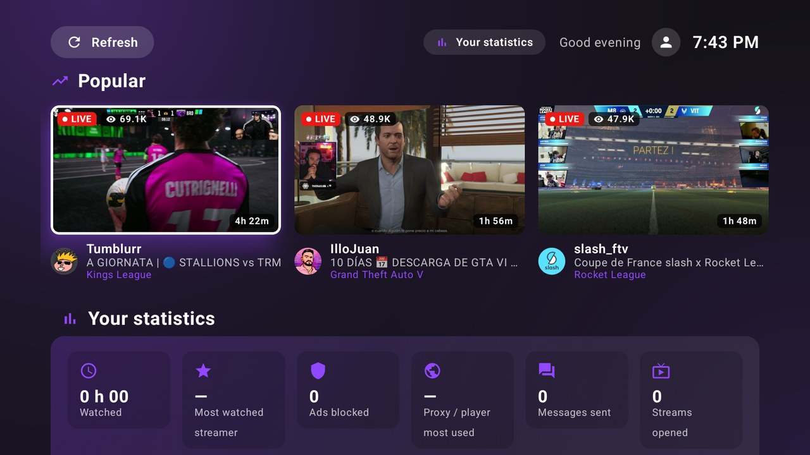
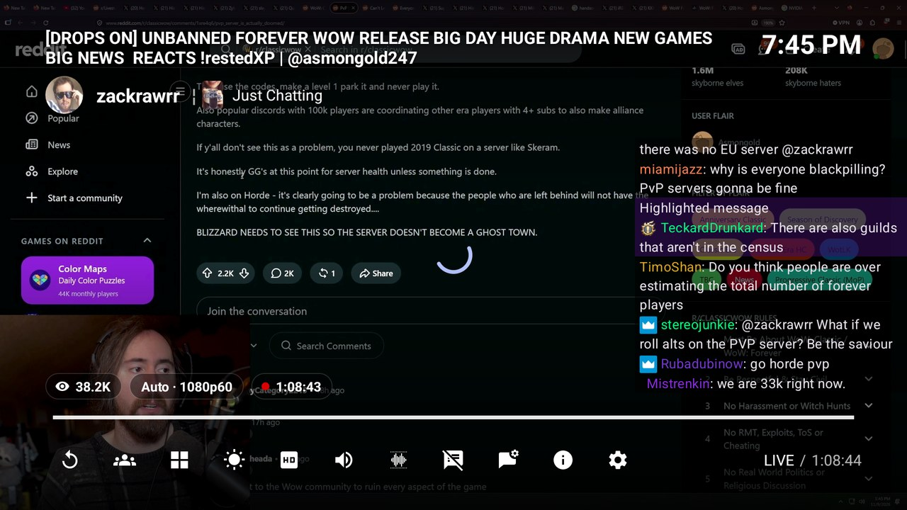
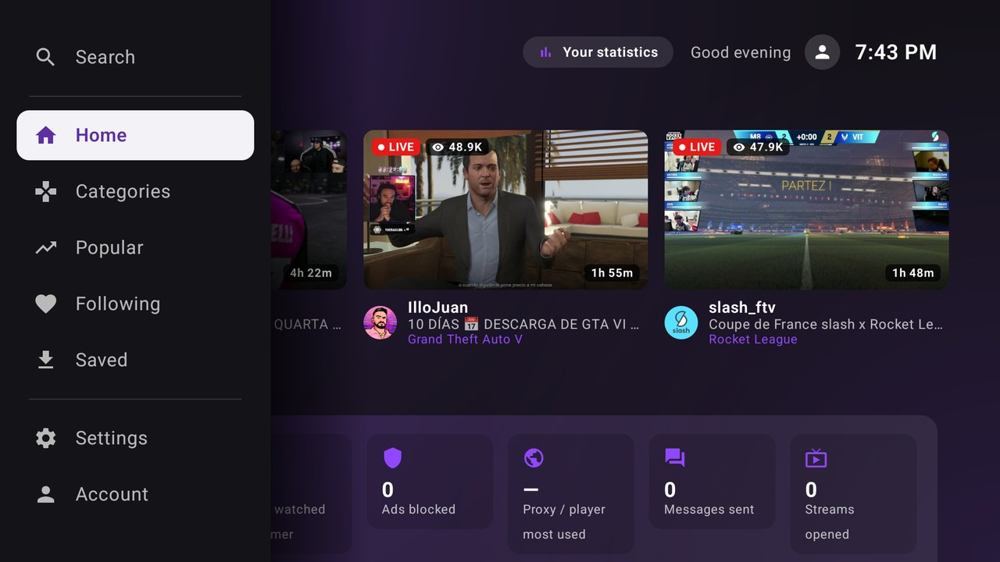
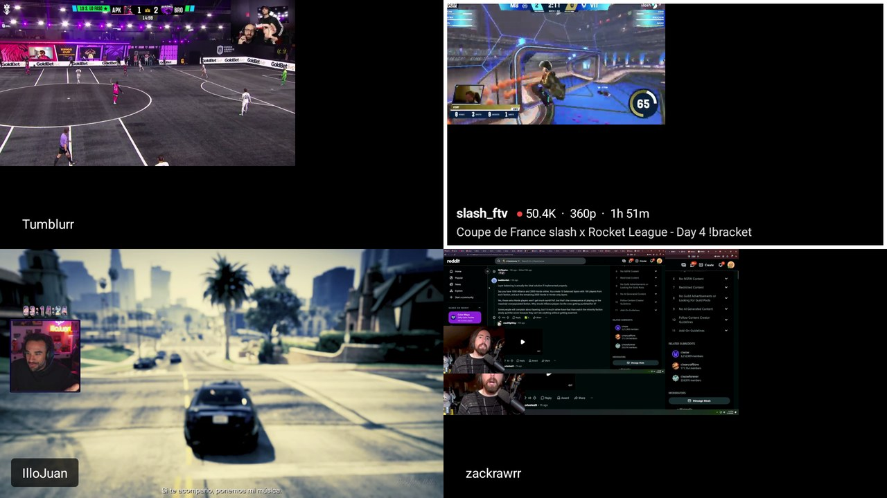
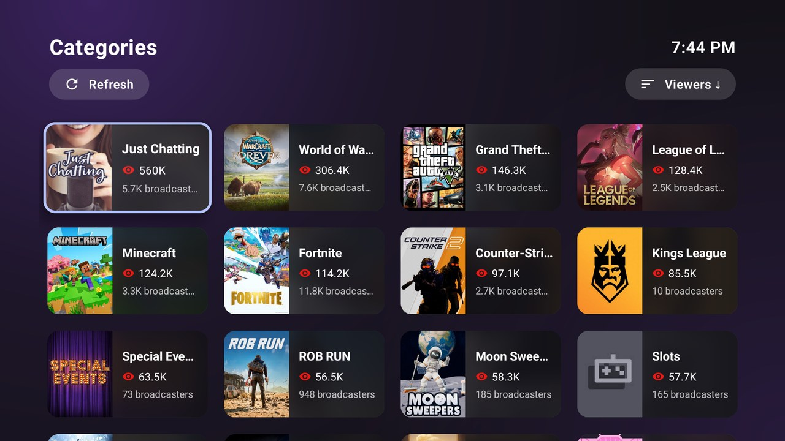
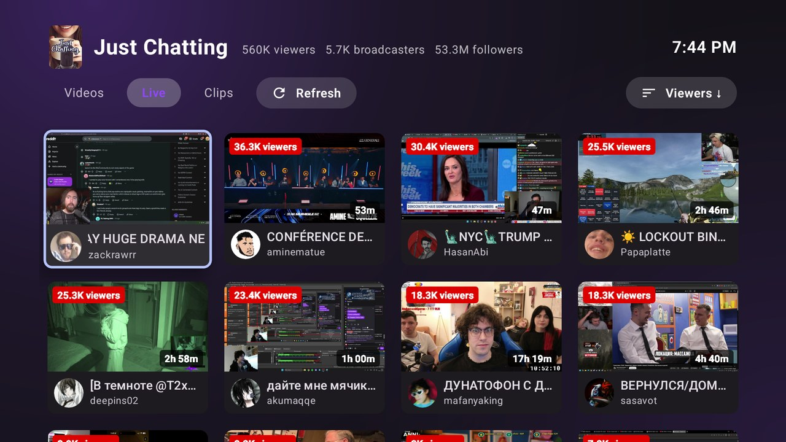
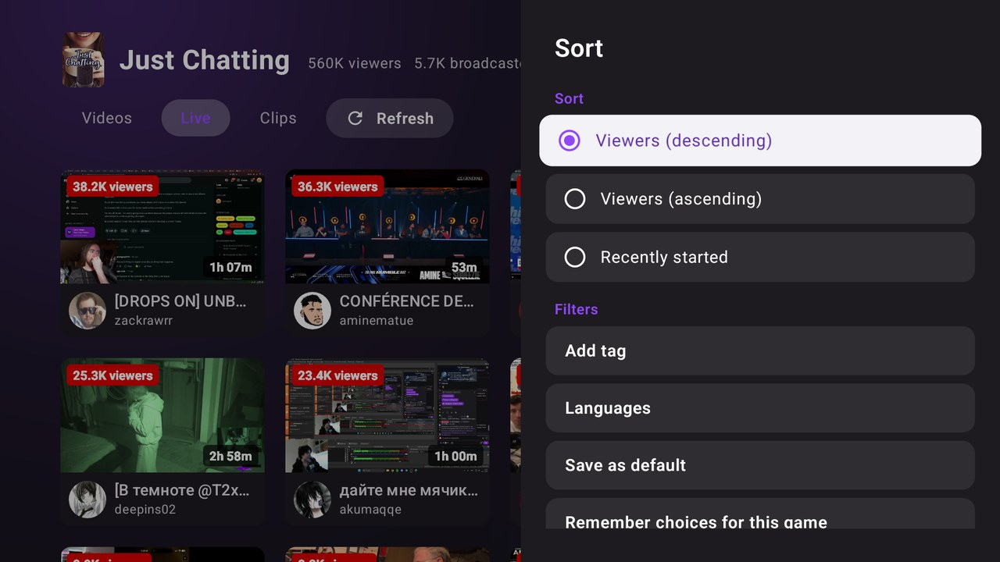
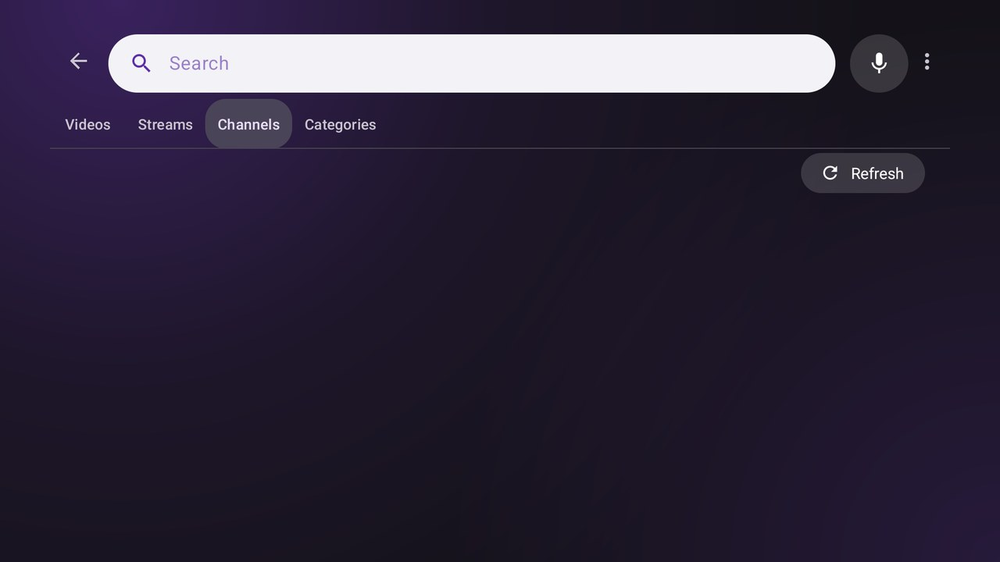

# Xtra TV


**Xtra TV** is a Twitch player and browser made for **Android TV**, built on top of [Xtra](https://github.com/crackededed/Xtra).
It brings a full TV interface designed for the remote, a built-in ad blocker (Proxy & VAFT), streams up to **1440p60**, multi-stream up to 4 channels, a live DVR timeline, and much more.

<br clear="left"/>

<p align="center">
  
  
</p>

## Download

Get the latest APK from the [Releases](https://github.com/razeNFR/XtraATV/releases/latest) page.

On a TV, the easiest way is the **Downloader** app (or any file manager): download the APK and install it (allow the installation of unknown apps for that app). From a computer: `adb install XtraTV.apk`.

Xtra TV has its own package name, so it installs next to the original Xtra.

## Features

- **Made for Android TV**: Leanback side menu, rows of live channels and categories, instant ad-free live video previews right inside focused cards, voice search, and quick D-pad actions.
- **Built-in Ad Blocker (Proxy & VAFT)**: Automatically switches to a proxy or an ad-free backup stream during pre-roll and mid-roll ads with a live progress badge, returning to the main stream with near-zero delay.
- **Up to 1440p60 - 4K (Enhanced Broadcasting)**: Plays the highest available stream quality automatically on Wi-Fi / Ethernet, with display **frame rate matching** and **audio normalization** (including during ad breaks).
- **Multi-stream & Picture-in-Picture**: Watch up to **4 live streams at once** (side-by-side, 2×2 grid, or Focus mode) with chats, same-category stream suggestions, live search, and per-stream audio controls, or open a second stream in a floating PiP window.
- **Live DVR & Sub-only VODs**: Rewind any live broadcast on the timeline with live video thumbnails, and watch subscriber-only VODs.
- **Customizable TV Chat & Quick Stream Switch**: Display chat as an overlay, side panel, or bottom ticker (with voice dictation), and switch between live channels instantly with D-pad Left / Right or Channel Up / Down.
- **QR Code Settings Backup**: Save and restore your settings directly on the TV, or transfer them to and from your phone over Wi-Fi by scanning a QR code.

## Log in

Two ways on TV: a **code to enter on twitch.tv/activate** from a phone or computer, or the **Twitch login page** inside the app.

## 1440p - 4K (Enhanced Broadcasting)

Twitch only serves the 1440p - 4K streams to its website client with a logged-in account. To enable them:
1. Log in with your Twitch account using the **Twitch login page** in the app (code login does not grant p).
2. Public proxies stop at 1080p: use the built-in ad blocker (**During ads** or **VAFT**), or your own proxy.
3. Keep **"Include token for streams"** enabled (default).
4. Your TV must support **H.265 (HEVC)** or **AV1** hardware decoding.

## Screenshots

| | |
|:-:|:-:|
|  |  |
| Leanback side menu | Home with rows and live preview |
|  |  |
| Player with HUD and chat overlay | Multi-stream (up to 4 streams) |
|  |  |
| Games | Category with live preview |
|  |  |
| Sort and filters panel | Voice search |

## Building

```bash
./gradlew assembleRelease
```
The APK is generated in `app/build/outputs/apk/release/`.

## Credits

Xtra TV is a fork of [Xtra](https://github.com/crackededed/Xtra) (originally by [AndreyAsadchy](https://github.com/AndreyAsadchy/Xtra)).
The ad blocker follows the logic of the [VAFT userscript](https://github.com/pixeltris/TwitchAdSolutions).

## License

Xtra TV is licensed under the [GNU Affero General Public License v3.0](LICENSE).
