# XtraPlus


**XtraPlus** is a Twitch player and browser for **Android TV and Mobile** (phones & tablets), built on top of [Xtra](https://github.com/crackededed/Xtra).
One single APK adapts automatically to your device — bringing a dedicated remote-first **Android TV** interface and a modernized Material 3 **Mobile** interface, with a built-in ad blocker (**Swap+**, **Swap / VAFT**, **VOD** & proxies), streams up to **1440p60 / 4K**, multi-stream up to 4 channels on TV, live DVR rewind, and much more.

<br clear="left"/>

<p align="center">
  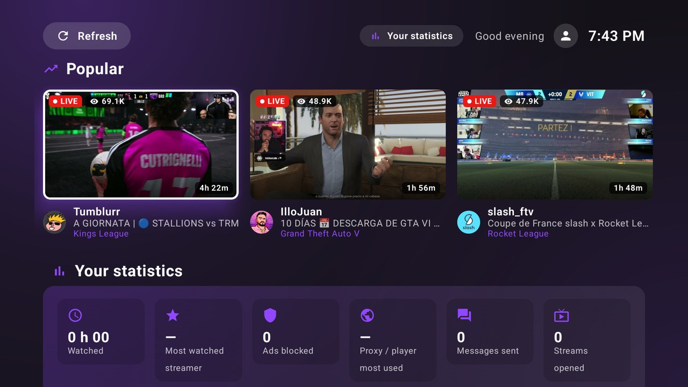
  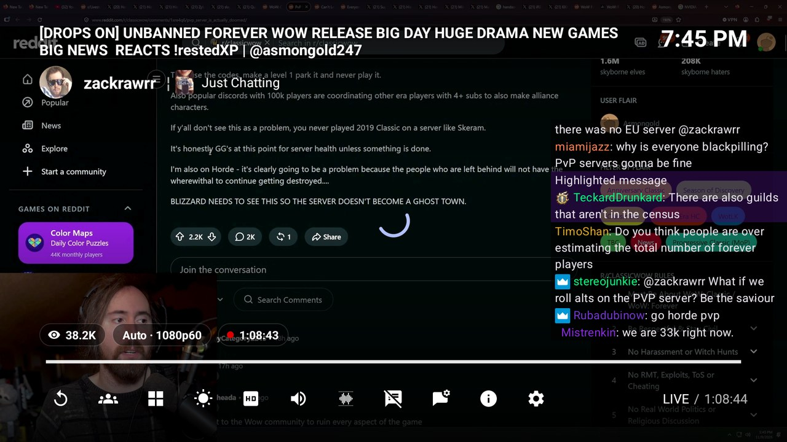
</p>

## Download

Get the latest APK from the [Releases](https://github.com/razeNFR/XtraPlus/releases/latest) page.

- **On Android TV**: install via the **Downloader** app (or any file manager) and allow installing unknown apps, or from a computer with `adb install XtraPlus.apk`.
- **On Mobile**: download and open the APK directly on your phone or tablet.
- **Note**: **XtraPlus** keeps its own package ID (`com.github.razenfr.xtratv`), so it installs alongside the original Xtra and upgrades seamlessly over previous Xtra TV versions without losing your accounts or settings. If an uncertified Android TV box opens in mobile mode (or vice-versa), you can switch manually in **Settings → Interface → Interface mode**.

## Features

### Shared (Android TV & Mobile)
- **Built-in Ad Blocker (`Swap+`, `Swap / VAFT`, `VOD` & Proxies)**: Seamless ad replacement inside the main player while preserving **1440p / HEVC / AV1** (`Swap+`), ongoing ad-free live VOD playback (`VOD`), classic backup swap, and custom/public proxy support with automatic fallback.
- **Up to 1440p60 - 4K (Enhanced Broadcasting)**: Plays the highest available stream quality automatically on Wi-Fi / Ethernet, with **audio normalization** and **DMCA-muted VOD audio recovery**.
- **Live DVR & Sub-only VODs**: Rewind any live broadcast on the timeline and jump straight back to live, watch subscriber-only VODs, and sync your watch history.
- **Multi-Account Support & Backup**: Switch between multiple Twitch accounts (or browse anonymously), and back up/restore settings locally or over Wi-Fi via QR code.

### Made for Android TV
- **Remote-first TV UI**: Leanback side menu, home rows of live channels and categories, instant ad-free live video previews inside focused cards, custom ambient colors & wallpapers, voice search, and quick D-pad actions.
- **Multi-stream & Picture-in-Picture**: Watch up to **4 live streams at once** (side-by-side, 2×2 grid, or Focus mode) with chats, same-category suggestions, live search, and per-stream audio controls, or open a second stream in a floating PiP window.
- **Customizable TV Chat & QR Companion**: Display chat as an overlay, side panel, or bottom ticker (with voice dictation), or scan a QR code to read and send chat messages directly from your phone over Wi-Fi.
- **Display Frame Rate Matching & Instant Zapping**: Automatic refresh rate switching and instant channel switching with D-pad Left / Right or Channel Up / Down.

### Modernized Mobile Experience
- **Material 3 Mobile UI**: Clean Dark, **AMOLED** (pure black), Light, and Dynamic themes paired with an independent **Accent color** (tinting streamer names, switches, tabs, navigation bar, and a subtle top ambient glow).
- **Touch-First Controls**: Modernized player HUD with quality/viewer/uptime pills, **Live DVR rewind**, native Material 3 Bottom Sheets (Accounts, Adblock & Proxies, Polls, Channel Points, Stats), long-press quick actions everywhere, and uninterrupted playback when browsing settings or switching apps.

## Log in

- **On TV**: use a **code on twitch.tv/activate** from a phone or computer, or sign in through the **Twitch login page** inside the app.
- **On Mobile**: tap the account avatar in the top bar to sign in, add multiple accounts, or browse in guest mode.

## 1440p - 4K (Enhanced Broadcasting)

Twitch only serves 1440p - 4K streams to its website client with a logged-in account. To enable them:
1. Log in with your Twitch account using the **Twitch login page** in the app (code login does not grant 1440p - 4K).
2. Public proxies stop at 1080p: use the built-in ad blocker (**Swap+**, **Swap**, or **VOD**), or your own 1440p-capable proxy.
3. Keep **"Include token for streams"** enabled (default).
4. Your device must support **H.265 (HEVC)** or **AV1** hardware decoding.

## Screenshots

### Android TV

| | |
|:-:|:-:|
| 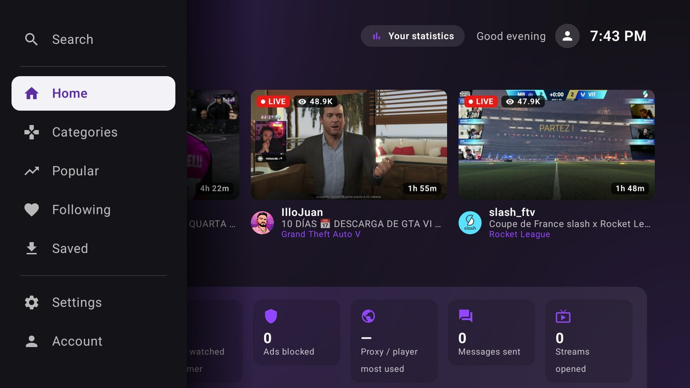 |  |
| Leanback side menu | Home with rows and live preview |
|  | 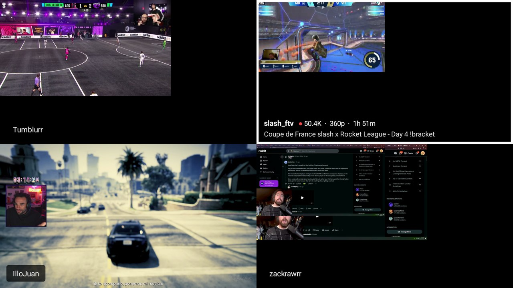 |
| Player with HUD and chat overlay | Multi-stream (up to 4 streams) |
| 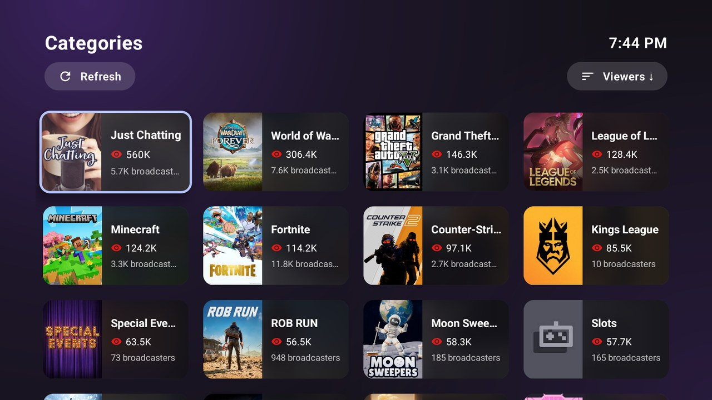 | 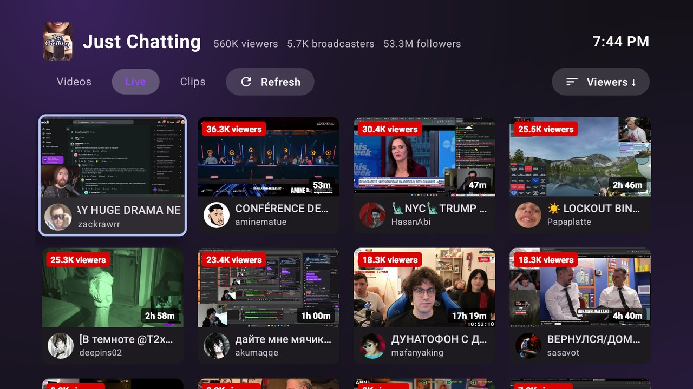 |
| Games | Category with live preview |
| 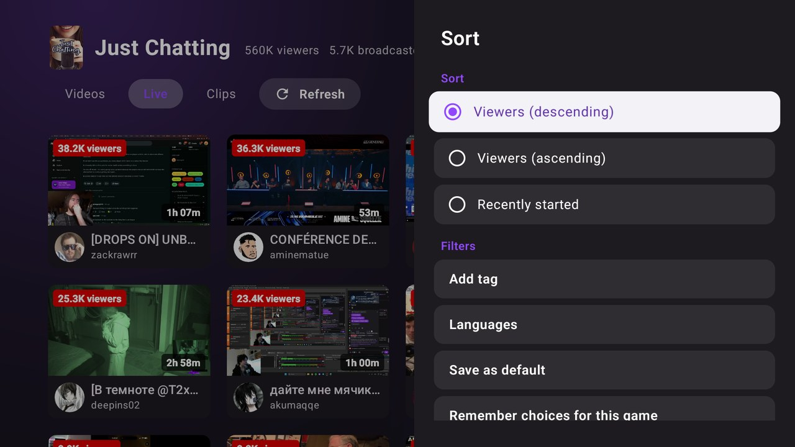 | 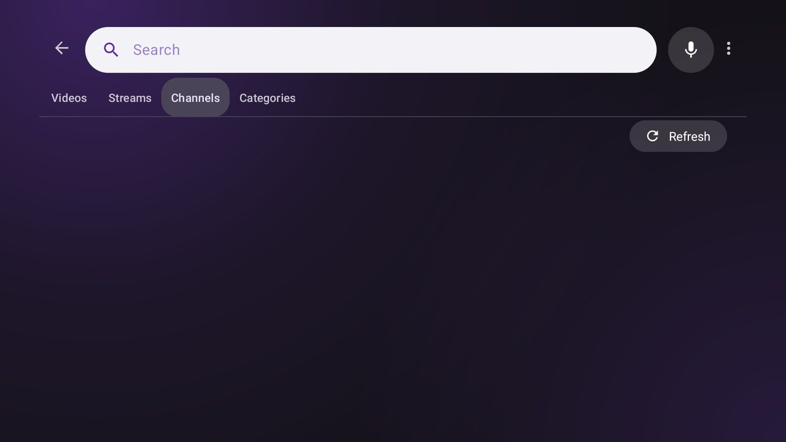 |
| Sort and filters panel | Voice search |

### Mobile

| | | | |
|:-:|:-:|:-:|:-:|
| 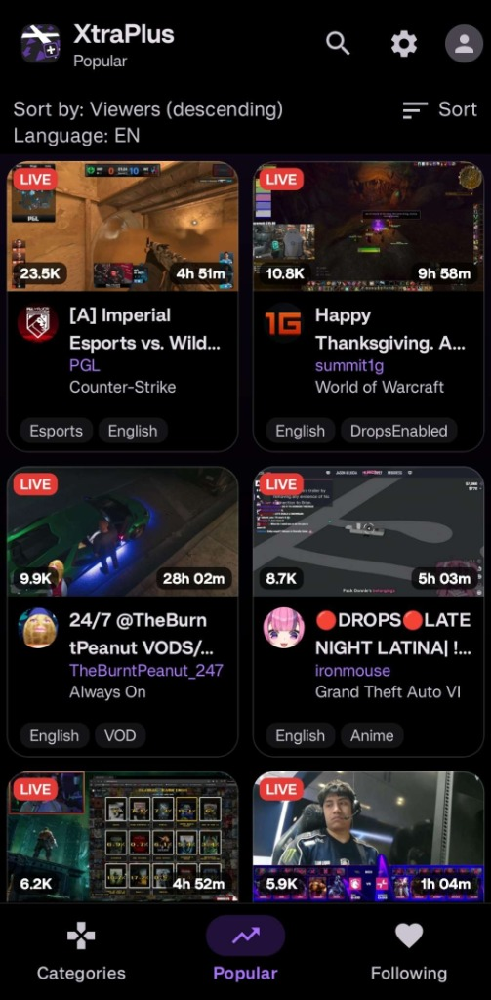 | 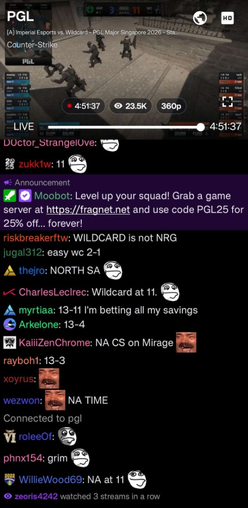 | 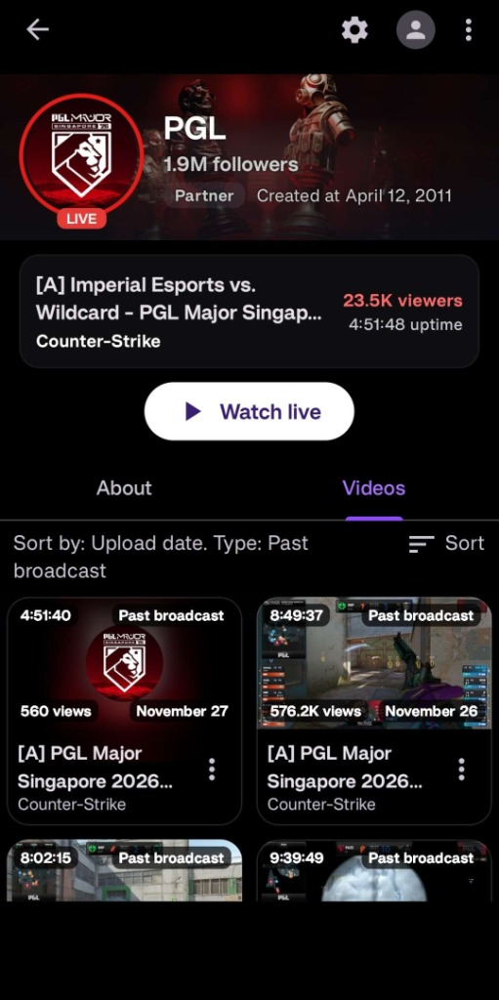 | 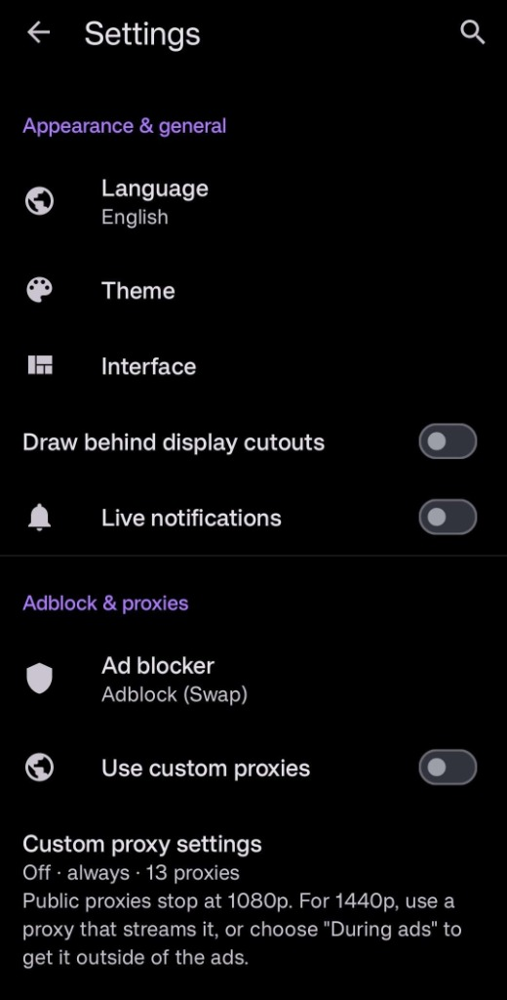 |
| Popular & Following | Player, DVR & Chat | Channel page & VODs | Modernized Settings |

## Deep Links & Automation

XtraPlus can open live streams, channel pages, VODs (with timestamps), clips, and categories directly from ADB, Home Assistant, tvQuickActions, or custom launchers. See [**docs/deeplinks.md**](docs/deeplinks.md) for all supported URLs and examples.

## Building

```bash
./gradlew assembleRelease
```
The APK is generated in `app/build/outputs/apk/release/`.

## Credits

XtraPlus is a fork of [Xtra](https://github.com/crackededed/Xtra) (originally by [AndreyAsadchy](https://github.com/AndreyAsadchy/Xtra)).
The ad blocker follows the logic of the [VAFT userscript](https://github.com/pixeltris/TwitchAdSolutions).

## License

XtraPlus is licensed under the [GNU Affero General Public License v3.0](LICENSE).
