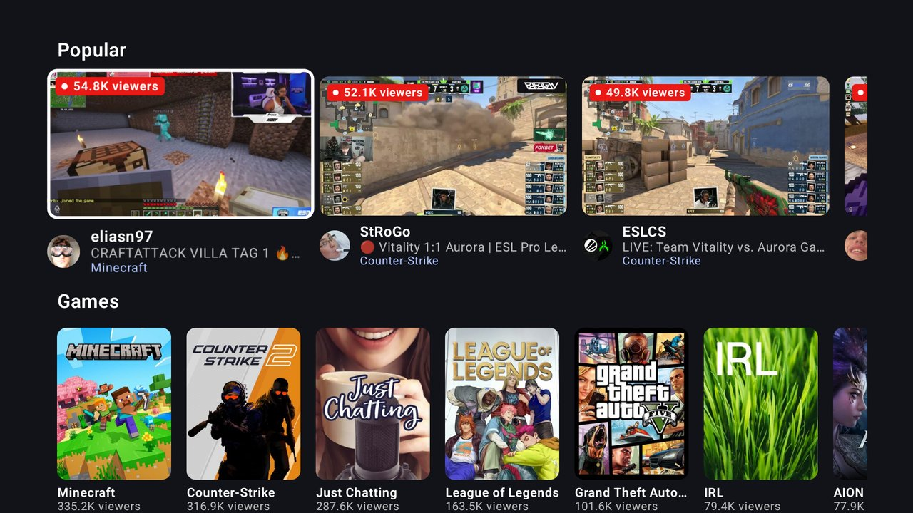
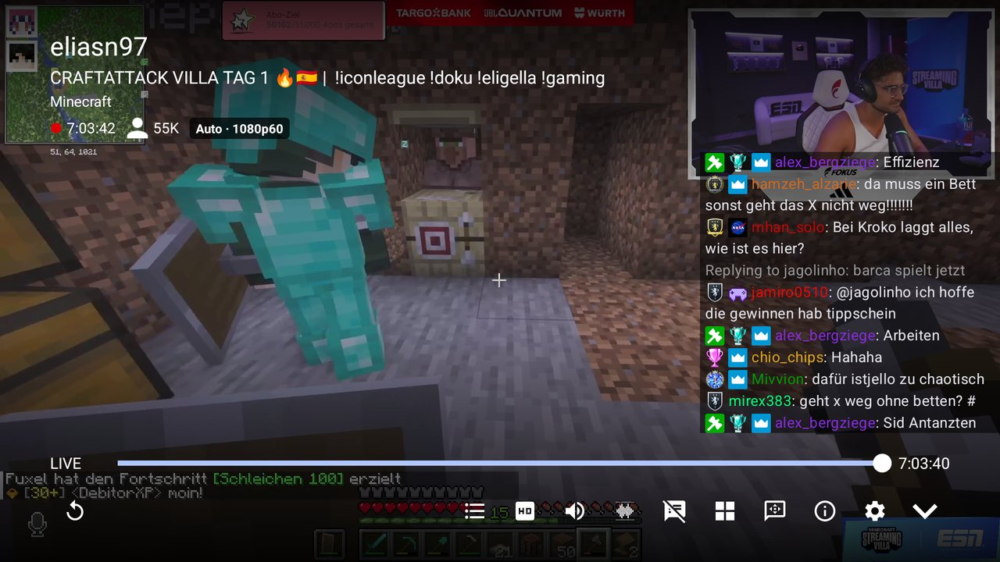
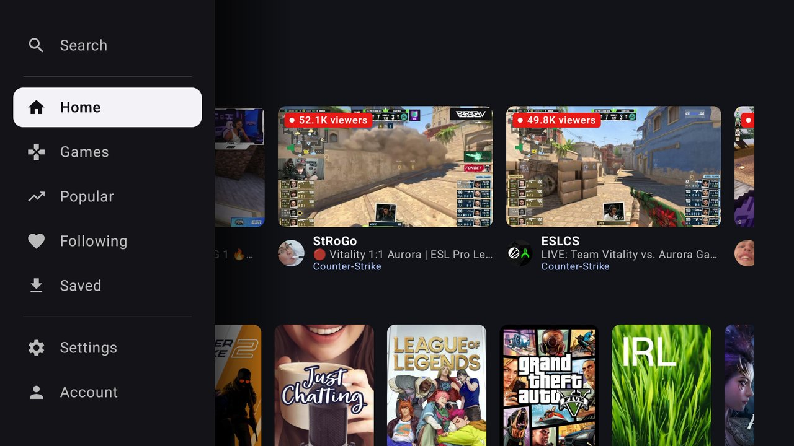
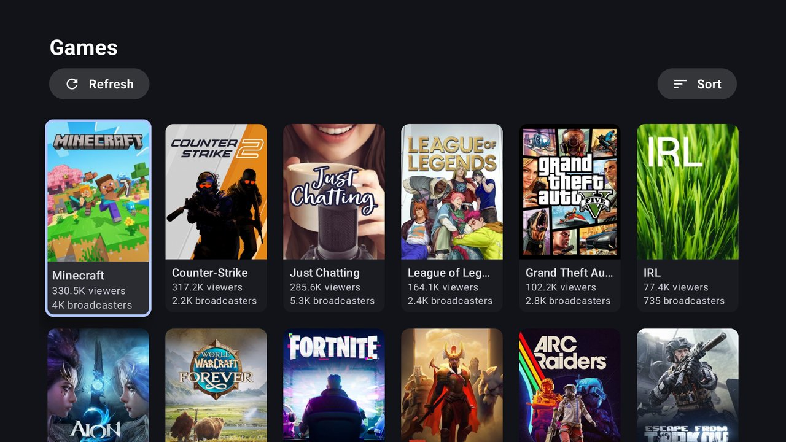
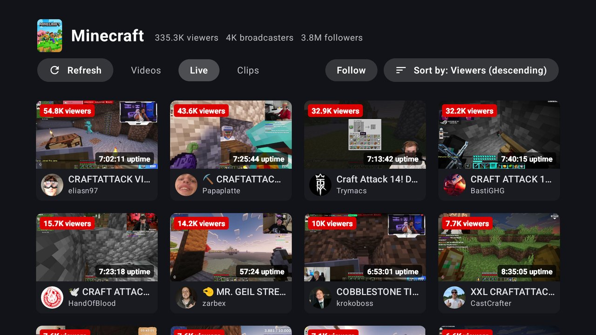
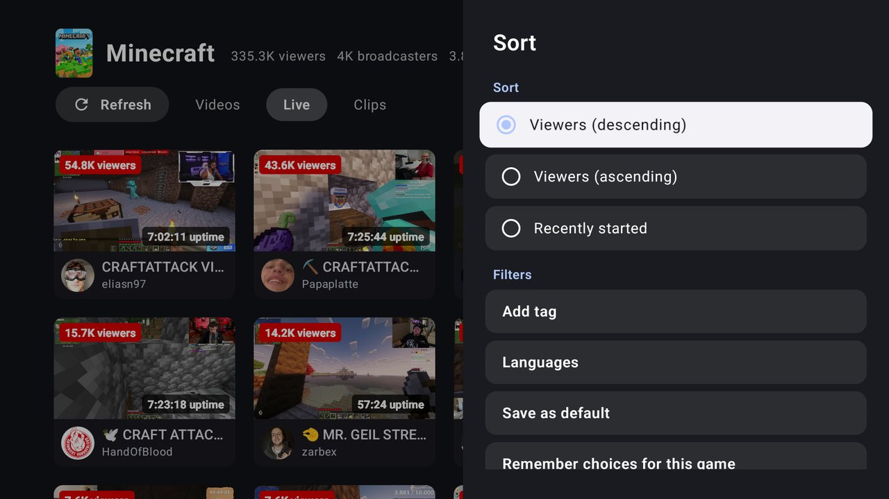
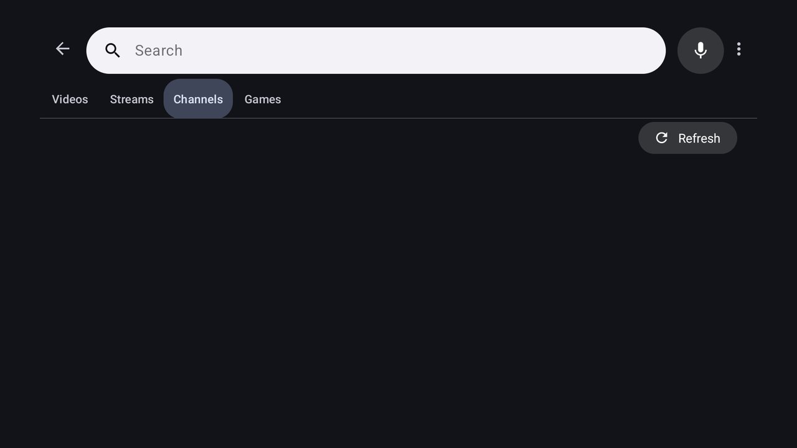

# Xtra TV


**Xtra TV** is a Twitch player and browser made for **Android TV**, built on top of [Xtra](https://github.com/crackededed/Xtra).
It brings a full TV interface designed for the remote, an ad blocker based on video swap, 1440p streams, multi-stream,
a DVR timeline on live streams and much more.

<br clear="left"/>

<p align="center">
  
  
</p>

## Download

Get the latest APK from the [Releases](https://github.com/razeNFR/XtraATV/releases/latest) page.

On a TV, the easiest way is the **Downloader** app (or any file manager): download the APK and install it
(allow the installation of unknown apps for that app). From a computer: `adb install XtraTV.apk`.

Xtra TV has its own package name, so it installs next to the original Xtra.

## Features

### TV interface
- **Home** with rows: followed channels live, popular streams and categories, with "See all" tiles and a refresh button.
- **Language filter** for the Popular row of the home.
- **Leanback side menu**: Search, Home, Games, Popular, Following, Saved, Settings and Account.
- **Live preview** of the focused stream, right inside its card: it starts right away in 360p, ad-free, with sound (option).
- **Big TV cards** with viewers, uptime, channel avatar and category.
- **Google TV like navigation**: the focused row stays in place with the rows before and after always in sight.
- **Long press OK** on a card: open the channel, open the category, more options.
- **TV header** on every list with refresh, sections and sort.
- **Sort and filter side panels**.
- **Voice search**: a search bar with a mic built in, the words show up while you speak and the search starts right away.
- **Channel page** made for TV.
- **Settings** fully usable with the D-pad, with up / down buttons to reorder lists.
- **Xtra TV settings**: every option added by Xtra TV in one screen.
- **TV banner and icon**.

### Player
- **TV controls** reachable with the D-pad, with tooltips and a badge with the quality being played.
- **Go back in time in a live stream**: the timeline covers the whole broadcast, going back plays the VOD being recorded, going to the end comes back to live.
- **Thumbnails on the timeline** while seeking, in VODs and in the past of a live stream (taken from the video itself while the broadcast is still going, Twitch makes its thumbnails only at the end).
- **Fast D-pad seeking** that speeds up while the key is held.
- **Sub-only VODs** playback.
- **Chat** over the stream, next to it or under it, with a **chat layout panel**: display, position, text size, width, height, distance from the edge and opacity.
- **Write in the chat** with the remote, with **voice dictation**.
- **Stream switcher**: a banner in the player with the other streams of the category you came from, with live previews.
- **Streamer switch shortcut** (option): left / right change streamer while the controls are hidden, channel up / down too. The previous and next streamers show on the sides of the screen for a few seconds.
- **Multi-stream**: up to 4 streams on screen at once.
- **Stats for nerds**: resolution, frame rate, codec, bitrate, buffer, latency, dropped frames.
- **Frame rate matching** (option): the TV switches to the refresh rate of the stream and keeps it matched while playing.
- **1440p streams** (Enhanced Broadcasting) on the channels that have it, see below.
- **Highest quality in Auto** on Wi-Fi / Ethernet.

### Ad blocker (video swap, like VAFT)
- When an ad starts, the player switches to the **ad-free stream of another player type** (embed, popout, autoplay), like the VAFT userscript, and comes back to the main stream when the ad is over.
- A **"Blocking ads" box** shows at the top right while it works.
- It **works with the proxies**: when a proxy lets an ad through, the ad blocker takes over.
- The **live previews** and every stream of the **multi-stream** are ad-free too.
- On by default.

### Languages
Everything added is translated into the 13 languages of the app.

## 1440p (Enhanced Broadcasting)

Twitch only gives the 1440p qualities to its website client with a logged in account. To get them:
1. Log in with your Twitch account in the app (the twitch.tv login page).
2. Keep **"Include token for streams"** on (default).
3. Your TV must decode **H.265 (HEVC) or AV1** in hardware.

## Screenshots

| | |
|:-:|:-:|
|  |  |
| Leanback side menu | Home with rows and live preview |
|  |  |
| Games | A category with the TV header |
|  |  |
| Sort and filters panel | Player with the chat overlay |
|  | |
| Voice search | |

## Building

```
./gradlew assembleRelease
```
The APK is in `app/build/outputs/apk/release/`.

## Credits

Xtra TV is a fork of [Xtra](https://github.com/crackededed/Xtra) (originally by [AndreyAsadchy](https://github.com/AndreyAsadchy/Xtra)).
The ad blocker follows the logic of the [VAFT userscript](https://github.com/pixeltris/TwitchAdSolutions).

## License

Xtra TV is licensed under the [GNU Affero General Public License v3.0](LICENSE).
